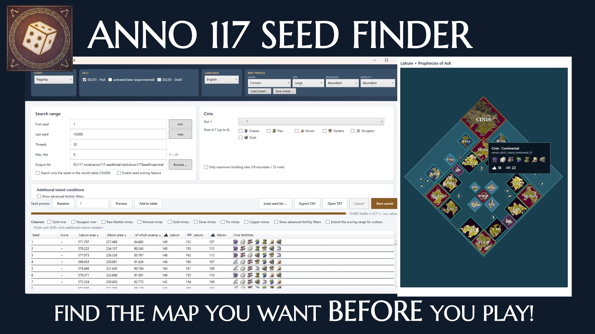

# Anno 117 – Seed Finder

Das deutsche Readme findet ihr [hier](README_de.md)



---

Find the map you want **before** you start a game.

When you begin a new game in Anno 117: Pax Romana you type in a seed number, pick a map shape, a size and a few more options - and the game builds a world from that. What you get is based on the so called "World Generator", which is driven by a few guidlines exposed to the player like map templats, but also RNG: which islands appear in their designated slots, how they are rotated, which fertilities spawn on them, how many mountain and river slots they have.

This tool rebuilds that "World Generator" **without starting the game**. It can run through millions of seeds in a few minutes and tell you which ones give you the map you are looking for - "a starting island with grapes and a gold river slot", "as much buildable tiles as possible", "at least a hundred mountain slots in Albion", and so on.

It is reverse engineered from real savegames and from the game's own data files, and it is checked against 90 savegames that cover every combination of settings. In those maps it reproduces **every island, every position, every rotation, every fertility, every building slot and every decorative island exactly** - 11,844 individual checks without a single mismatch.

---

## Contents

- [What a seed is](#what-a-seed-is)
- [Installing and starting](#installing-and-starting)
- [Using the app](#using-the-app)
- [Settling guide and playstyle ratings](#settling-guide-and-playstyle-ratings)
- [How Anno 117 builds a map](#how-anno-117-builds-a-map)
- [How exact is this?](#how-exact-is-this)
- [Known limits](#known-limits)
- [Building it yourself](#building-it-yourself)
- [Credits](#credits)

---

## What a seed is

A seed is just a number. The game uses it to start a long chain of "random" numbers. The chain is not really random: the same seed always produces exactly the same chain, and therefore exactly the same map. That is what makes a seed finder possible at all - if you know the rules, you can compute the map from the number without playing.

Change anything else - the map shape, the size, the DLC, the two map options - and the same seed gives a completely different world, because the rules consume the number chain differently. That's why this tool is very critical when it comes to game updates. Especially fertility distribution is very sensitive to minor changes somewhere in the chain.

---

## Installing and starting

**What you need**

- Windows
- [.NET 10 Desktop Runtime](https://dotnet.microsoft.com/download/dotnet/10.0) (the "Desktop" variant, not just the
  console one)

**Starting**

Run `Anno117SeedFinder.exe`. There is no installer and nothing is written outside the folder you put it in. The app does not need the game, the game files or an internet connection.

The interface is available in **English and German**; switch it with the language box at the top right. Your choice is remembered in your presets.

---

## Using the app

The window is split into three parts: the **map profile** at the top, the **search conditions** in the middle, and the **results** at the bottom.

### 1. The map profile - describe the game you are going to start

These settings must match what you will later choose in the game's "New Game" screen. If they do not match, the seeds you find will produce a different map.

| Setting | What it means |
|---|---|
| **Map template** | The shape of the world: Archipelago, Atoll, Corners, Island Chains or Rift. Each one places the islands in a completely different and distinct pattern. |
| **Map size** | Small, Medium or Large. Larger maps have more islands and more space between them. |
| **DLC01 – PoA** | Whether *Prophecies of Ash* DLC is active. With it, Latium is expanded by the continental island Cinis, and gains several extra islands in the Northern corner of the map. On by default; the app remembers it when you switch it off (in `dlc.txt` next to the app). |
| **activated later (experimental)** | For maps that were **created without** the DLC01 and had it switched on afterwards. See [Switching the DLC on later](#switching-the-dlc-on-later). |
| **after loading a save** | For games that were started **after a savegame had been loaded** (load a save, *Quit to Title*, then *New Game*). The game then places only 10 instead of 14 small decoration islands in Latium, and every island's slots and fertilities come out different. A game started right after launching Anno is the normal case. Count the small decoration islands in Latium: 10 means tick this box. |
| **DLC03 – DotD** | Greyed out. DLC03 *Dawn of the Delta* is prepared for, but not active yet. |
| **Start mode** | Flagship or starting island. This is the game's choice of how you arrive in the map; it does **not** change the generated map. Tested with the starting-island option switched on, with the continental island forced as the start, and with DLC01 on and off (Archipelago and Corners, Large): all six savegames are identical to the plain ones. |

### 2. Additional map options

The game offers you a few extra choices when you create a map. Two of them change what this tool computes:

| Option | Effect |
|---|---|
| **Resource slots** (Abundant / Regular / Sparse) | How many mountain and river slots the islands get. |
| **Fertility** (Abundant / Regular / Sparse) | How many fertilities are generated on each island. |

A third option, **forest size** (how large the forest patches are on an island), was measured and has **no effect at all** on islands, positions, fertility or slots - so it is deliberately not offered here.

### 3. What to search for - the conditions

Everything in the middle of the window is optional. Leave it all empty and every seed matches.

**Island conditions.** For each region (Latium and Albion) you can demand specific characteristics on specific kinds of island:

- **Starting island** – the island you actually begin on
- **Secondary** and **Tertiary** – the two groups the remaining islands are split into (explained [further down](#step-8-which-goods-grow-where))
- **Any combination** – the fertility simply has to exist somewhere in that region

Use the "add" buttons to create a condition row, then pick the fertility distribution for the island. You can add as many rows as you like; a seed has to satisfy all of them. The position picker next to a row lets you demand the island on a **particular island slot** of the map, if you care where it is.

**Cinis (with DLC01 only).** The volcanic island has its own set: you can require particular fertilities there, demand a specific one in its first slot, or require the maximum number of building slots on the island.

**Minimum sizes.** Three sliders demand a minimum amount of usable tiles: buildable area in Latium, in Albion, and marsh area in Albion. The "median" button next to each one fills in the typical value for the current map profile, so you can quickly ask for "better than average" (derived of 100k seeds).

**Minimum building slots.** A row of boxes lets you demand a minimum number of mountain slots, river slots, gold river slots, sturgeon river slots, gold mines, raw marble mines and mineral mines in Latium, silver, tin and copper mines in Albion. Again each has a "median" button. The mountain and river slot totals are always shown; the fertility-specific ones (gold and sturgeon river slots and the single mines) appear with **Show advanced fertility filters** and only apply while it is on.

**Advanced fertility filters.** The check box **Show advanced fertility filters** above the results table reveals six more sliders and adds their columns to the table. Each one adds up the harbour or swamp tiles of all islands in the region that carry a given fertility: harbour tiles of the Murex islands and of the Oyster islands in Latium; harbour tiles of the Saltwort islands and of the Sea Shell islands in Albion; swamp tiles of the Small Birds islands and of the Beaver islands in Albion. The sliders move in steps of 500 tiles and have a "median" button like the others. Filters are only applied while the check box is on; the box is saved with the presets.

**Seed scoring.** A hard filter is all-or-nothing; scoring lets you rank the seeds that pass by how well they match what you actually care about, instead of throwing away a seed that is 2,000 tiles short of a cutoff but excellent everywhere else. Tick **Enable seed scoring** (next to "Search only the seeds in the results table") to reveal a weight slider (0-10) next to every area, site, mine and advanced-fertility filter, next to the six Cinis pool fertilities, next to the Cinis slot 1 choice, and next to "only maximum building slots" - independently of whether that same thing is also a hard filter. Every seed then gets a score out of 10, shown in its own column (sortable, and part of multi-sort); a dash means no weight is set. Weights are normalized against the same 100k-seed statistics as the filters, so a weight of 10 on "mostly full range" and a weight of 10 on "narrow range" count the same. **Extend the scoring range for outliers** (next to "Show advanced fertility filters") stretches a metric's range to fit an unusually extreme hit from *this* search instead of just capping it at 1.0 - useful for metrics with a narrow 100k-seed spread, like tin mines. Hover a score to see the breakdown per metric. Weights and both switches are saved with presets and exported in the CSV.

### 4. Running a search

| Field | Meaning |
|---|---|
| **First / last seed** | The range to scan. The buttons next to the fields jump to the smallest and largest seed the game accepts. |
| **Threads** | How many processor cores to use. More is faster; leave the machine one core if you want to keep working. |
| **Maximum hits** | Stop after this many matching seeds. `0` means "find them all". |
| **Output file** | Where the matching seeds are written. The moment the search starts is stamped into the actual file name (`treffer.txt` becomes `treffer_2026-09-23_15-04-05-123.txt`), so leaving this box unchanged between two searches never overwrites the previous run's results. |
| **Search only the seeds in the results table** | Runs the search over the seeds that are currently in the table instead of over the range (see "Filtering step by step" below). Only available while the table has seeds. |

Press **Start** to run and **Cancel** to stop early. Results appear in the table as they are found.

**How fast is it?** Measured with the built-in `--benchmark` switch on a Ryzen 9 9950X3D (16 cores, 32 threads), Corners Large with DLC01:

| Work per seed | 1 thread | 32 threads |
|---|---|---|
| A search with Latium filters (the usual case) | about 5,700 seeds/s | about 93,000 seeds/s |
| Generating Latium alone | about 5,700 seeds/s | about 90,000 seeds/s |
| Generating Albion alone | about 10,300 seeds/s | about 173,000 seeds/s |

So a million seeds take about 11 seconds on all cores, and the whole range the game accepts (almost a billion seeds) takes about three hours. Albion is generated only for seeds that already passed Latium (or first, when its filters are the stricter ones). A slower machine scales roughly with its core count.

### 5. Results

The table lists every matching seed with its key numbers: buildable tiles per region, marsh area, slot counts and the fertility distribution on Cinis. By default the table stays compact: the areas and the total mountain and river slots of each region. Headers marked ▦ are tile counts. Ticking **Show advanced fertility filters** adds every fertility-specific column (gold and sturgeon river slots, the single mines, the advanced filter columns) together with the matching filter rows. Numbers follow the window language: German groups thousands as 1.234, English as 1,234. When all columns do not fit the window, the table scrolls sideways. Hover any of these numbers for a small gauge: where this seed's value falls between the 100k-seed population's minimum and maximum, with the median marked, so a bare number like "145" gets context without opening the corresponding filter.

- **Preview** – type a seed and press Preview to see both regions drawn as a map: every island exactly where the game puts it and turned the way the game turns it, with its top-down image, plus the decoration islands and the third-party islands (traders and the raider). Hover an island for its fertilities and slot counts; the outline colour on hover shows its role. The border of the regular map and of the Prophecies of Ash area are drawn as the real rectangles. This works for any seed, whether it came from a search or not. **Random** puts a random valid seed into the box. The islands can be drawn as a **tile map** (the default: every tile coloured by type - buildable, marsh, river, harbour, not buildable) or with the game's **artwork**. Zoom with the slider, the + and − buttons or Ctrl + mouse wheel (around the cursor), drag with the left mouse button to move around, and **Fit** shows everything again; in the tile map every pixel is one tile. The island tooltips also show the tile breakdown: buildable land, marsh (Albion) and harbour.
<<<<<<< Updated upstream
=======
- **Islands on the map** – **+ Island** (next to the condition buttons of each region) adds a rule for one specific island, named as in the game files (XL01, L06, M03, PoA M01 …): it **must appear** or **must not appear** on the map, either anywhere or only in the positions you pick (the position picker offers only the slots that can hold that island), and optionally only with a certain **rotation** (0°, 90°, 180°, 270°). Example: "M03 must not appear" drops every seed with Latium M03; "L02 must appear at #5 with 90°" keeps only seeds with exactly that. The preview's island tooltip shows each island's short name and rotation. Starting islands always turn to face the map centre, so their rotation follows from their position.
- **Settling guide** – tick **Settling guide** in the preview to see which islands to settle, and in which order, to reach every fertility of a region with few, valuable islands close to each other. How it works and how it scores: [Settling guide and playstyle ratings](#settling-guide-and-playstyle-ratings).
- **Playstyle fit and Seed Atlas export** – with the settling guide ticked, the preview rates the seed above the maps for three playstyles (Casual players, Full supply, Record builders), and **Seed Atlas export …** writes annotated map images and the seed description for the Seed Atlas on anno-companion.com; see [Settling guide and playstyle ratings](#settling-guide-and-playstyle-ratings).
>>>>>>> Stashed changes
- **Add seed** – put a single specific seed into the table without searching.
- **Load seed list** – read a list of seeds from a file and evaluate them all in the results table. A plain text file with one seed per line (like the output file, `treffer.txt`) and a CSV exported by the app both work; other columns are ignored. The seeds carry no map profile: set the profile they were found with before you load them.
- **Export CSV** – write the results table to a spreadsheet file. The suggested file name is stamped with the current moment the same way, so clicking Save without renaming still keeps every export.
- **Table tools** (the row above the table, most of them also on right-click): **Find seed** jumps to a seed number in the table (Enter works too; separators are ignored). **Clear sorting** removes every column sorting and brings the original order back. **Clear table** empties the table (the search output file is kept).
- **Compare seeds** – select a row and click **Set as reference** (★, amber), then select the seeds to compare with Ctrl+click or Shift+click and click **Compare selected**. The table then shows only the reference and those seeds, and every number is green where a seed beats the reference and red where it falls short (higher is better in every column, the score included). A seed added with **Add seed** during a comparison joins it; **End comparison** shows every row again.

#### Filtering step by step

A search can be narrowed down in stages, also across sessions:

1. Run a search (or load an earlier `treffer.txt` / CSV with **Load seed list**). The table now holds a set of seeds.
2. Change the filters, tick **Search only the seeds in the results table** and press **Start**. Only those seeds are examined, and the table is replaced by those that also pass the new filters.
3. Repeat with other filters as often as you like, for example first all seeds with the most buildable tiles, then of those the ones with the most gold slots.

If no seed passes the new filters, the table goes back to the list it had before and the output file is left as it was, so you can change the filters and try again without loading anything. The first and last seed fields are switched off while the option is on. The hits are written to the output file as usual, under its own time-stamped name (see "Output file" above), so this never touches the file you loaded, even if the output box still names it.

### 6. Presets

**Save preset** and **Load preset** store everything - profile, options, all conditions, the search range and the
language - in a small file, so you can come back to a search later or share it with someone.

---

## Settling guide and playstyle ratings

### The settling guide

Tick **Settling guide** in the seed preview to see which islands to settle, and in which order, to reach every fertility of a region with few, valuable islands close to each other. Numbered badges mark the islands on the map (Latium 1, 2, 3 …; Albion R1 … for the Romans and C1 … for the Celts), the supply routes from the main island are drawn as dashed lines, and a panel under each map lists every step with the fertilities it adds. Albion needs their own islands for each population, so both orders are listed (for example Romans first, Celts first) with their scores; pick the one to draw on the map and to use in the export. With the start mode "starting island" the first Latium island is a starting island. Tick **Cinis off** to leave Cinis out of the Latium plan.

**What a plan is.** The first island is the population's main island: its hub, which supplies every later island. Each further island must add at least one fertility that is still missing, until every fertility of the region is covered; an island whose fertilities the others of the plan bring anyway is never part of it. After the main island the plan follows the population tiers: the next island always adds a fertility of the lowest tier still missing (an island counts at the lowest tier it adds). Iron is optional: it counts when an island brings it, but no island is settled for iron alone. The app tries every possible order and shows the best one, so a map always gets the same guide.

**How a plan is scored.** Every step earns points for the island, multiplied by 0.9 per step (the main island counts fully, the second island 0.9 times, the third 0.81 times …), and the plan loses points for its length and its distances:

| | Latium | Albion |
|---|---|---|
| Each fertility the island adds | see the weights below | see the weights below |
| Slots | +10 per river slot, +5 per mountain slot | +10 per mountain slot, +5 per marsh slot |
| Island size | Cinis 500, XL 450, L 150, M 75, S 30 | L 200, M 100, S 10 |
| 2nd, 3rd, 4th … island | −200, −400, −600 … | −150, −300, −450 … |
| Open water to the main island | −0.2 per map unit | −0.2 per map unit |

On top of that:

- **Raiders:** a supply route from the main island that passes closer than 500 map units to a raider base costs 1 point per unit it comes closer (a route touching the raider: −500).
- **Map edges:** every island costs 0.05 points per map unit of distance from the preferred edges (Latium north-west and south-east, Albion south-west).
- **Main island size:** a medium main island costs 150 points, since players rarely start on one when a large island fits nearly as well. A small island is never a main island (only when no plan works without one; it then costs 300). In Latium a large main island costs 100 points while an XL island or Cinis could start the plan instead. Without it the guide would often start on a central large island, because an island's size bonus counts wherever it comes in the order.

**Fertility weights.** A fertility is worth points by the production chains that need it: about +70 per tier-2 chain, +50 per tier-3 chain and +30 per tier-4 chain, building materials counting half. A fertility counts the same whatever slots the island has: the slots count on their own, through the slot points in the table above.

- **Latium:** Mackerel, Lavender, Resin, Olives 70 · Grapes 50 · Flax, Murex 80 · Sandarac 140 · Minerals 125 · Marble 145 · Oysters 30 · Sturgeon 30 · Gold 90 · Iron 50.
- **Albion:** Barley 70 · Dye Plants, Copper 190 · Tin 140 · Saltwort 100 · Beavers, Ponies 50 · Herbs 70 · Silver, Resin 120 · Small Birds, Flax, Sea Shells, Iron 50 · Granite 75.

**Population tiers** (the order after the main island):

- **Latium:** tier 2 Resin, Olives, Iron; then Mackerel and Lavender (optional at tier 2, so they come after Resin and Olives); tier 3 Grapes, Flax, Murex, Sandarac, Minerals, Marble; tier 4 Oysters, Sturgeon, Gold.
- **Albion:** tier 2 Barley, Dye Plants, Copper, Tin, Iron, Herbs, Silver, Resin; tier 3 Saltwort, Beavers, Ponies, Granite, Small Birds, Flax, Sea Shells.

**Two populations (Albion).** Romans and Celts are planned one after the other: first the population you start with, then the second one, which may not use the first one's main island and has a main island of its own. The second population gets a bonus for every island it shares with the first plan: +500 per new fertility after the Romans, +200 after the Celts. A plan uses at most four islands per population (more only when no such plan covers every fertility). Two bonuses make an island a good main island or a good Celtic island:

- **Tier-3 goods on the main island:** every Albion tier-3 good worth having from the start (Ponies, Small Birds, Sea Shells) on a population's main island earns +1,000.
- **Tin and copper on one island** (Albion): most useful together for bronze, so the island earns +100 more.

In Albion both bonuses scale with the island's building space, because they pay off only with room to produce the goods: a large island earns the full bonus, a medium island (about half the building space of a large one) half of it, a small island 15 %.

The idea and the scoring model come from **ewjax** (see [Credits](#credits)).

### Playstyle ratings

With the settling guide ticked, the preview rates the seed above the maps for three playstyles from 0 to 100; hover a chip for the details. Each rated property gets a rating between 0 (the lowest value seen on this kind of map) and 1 (the highest); the score is the weighted mean of the ratings. "This kind of map" means the same template, size and difficulty: the ranges come from 100,000 seeds per template and size, and for the Regular and Sparse fertility and resource slot settings from 20,000 seeds per setting, as those maps have far fewer mines and fertile coasts. Properties of Cinis count only with DLC01 on. A ✓ means the seed meets every minimum of the playstyle; only Record builders have one.

**Casual players** – good fertility spread and an easy settling order on large islands close to each other.

| Property | Weight |
|---|---|
| Ideal Minerva starting island (Flax, Murex, Sturgeon, Oysters on XL or Cinis) or Neptune island (Mackerel, Murex, Oysters, Sturgeon on XL, Cinis or L) | 10 |
| Ideal Ceres island (Lavender, Olives, Grapes, Marble on L or XL) | 8 |
| Ideal third island (Flax, Gold, Sandarac, Minerals on L or XL) | 6 |
| Gold and Sturgeon river slots | 5 |
| Cinis: Sturgeon, Oysters, Lavender, Gold and the most slots | 5 |
| Ideal Roman starting island (Herbs, Resin, Silver, Flax, Small Birds; Sea Shells on another island) | 8 |
| Ideal Celtic starting island | 8 |
| Settling guide, Latium: main island (Cinis, XL01 or XL04 best), number of islands (3 or fewer ideal), their sizes, open water, distance to the raiders | 4, 8, 6, 6, 3 |
| Settling guide, Albion: number of islands (5 or fewer ideal), their sizes, open water | 7, 5, 5 |

**Full supply** – lots of building space and river slots, good coasts and marshes and enough mines to fully supply every residence. No minimums: some templates simply do not suit this playstyle, which shows in their scores.

| Property | Weight |
|---|---|
| Latium building space | 10 |
| Latium river slots | 10 |
| Harbour tiles of the Murex islands / Oyster islands | 6 / 4 |
| Marble slots | 6 |
| Albion building space | 10 |
| Harbour tiles of the Saltwort islands / marsh of the Small Bird islands | 4 / 8 |
| Marsh of the Beaver islands / harbour tiles of the Sea Shell islands | 3 / 6 |
| Silver mines | 8 |
| Mineral mines / gold mines (Latium) | 6 / 6 |
| Copper mines / tin mines (Albion) | 6 / 6 |

**Record builders** – the most building space and river slots, plus marble and tin. Minimum: Latium and Albion building space each rated at least 95 %, i.e. close to the most the map allows.

| Property | Weight |
|---|---|
| Latium building space / Albion building space | 10 / 10 |
| Latium river slots | 10 |
| Harbour tiles of the Murex islands / Oyster islands | 4 / 2 |
| Marble slots / tin mines (Albion) | 6 / 6 |
| Albion islands with Resin (L/M) | 6 |
| Harbour tiles of the Saltwort islands | 2 |
| Murex on Cinis / Oysters on Cinis | 2 / 2 |

**Seed Atlas export …** writes one annotated map image per region (the tile map with the settling guide and, for every island of the plan, a card with its fertilities and slots) and the seed description as an Elementor template in English and German for the Seed Atlas on anno-companion.com. The text follows the orders chosen in the guide panels. Tick **Pick islands** to choose the islands yourself: each click on an island adds it (in click order; in Albion each further click switches between Romans, Celts, both and none). Your selection then replaces the settling guide on that map and in the export, e.g. to point out a perfect Ceres island the guide passes over.

---

## How Anno 117 builds a map

This is the part the tool had to reproduce. It is described here in plain language; you do not need any of it to use the app, but it explains what the settings really do.

### The dice

Everything starts with the seed. The game turns it into a set of **17 numbers**: it takes the seed and repeatedly multiplies and adds a fixed amount, filling the 17 places one after another.

From then on, every "roll of the dice" works the same way: the game takes two of those 17 numbers, rotates their bits (nine steps for one, thirteen for the other), adds them together, and writes the result back over one of the two. A pointer moves on, and the next roll uses the next pair. So the 17 numbers keep stirring each other, and out comes a
stream of numbers that looks random but is completely determined by the seed.

Two things matter for understanding the rest:

1. **The order is everything.** Each step of map generation takes a certain number of rolls from this stream. If one step takes one roll too many or too few, everything after it shifts and the map changes completely. This is why a single misplaced decorative island can ruin the fertility of an entire map.
2. **The first nine rolls are skipped.** The game uses them elsewhere before map generation starts.

### Step 1: the template

Each map shape and size is a file in the game that lists **slots** - fixed spots where an island may go, each with a size (small, medium, large, extra large) and a marker saying whether it is a *starting* slot. The template also holds the spots for the three neutral parties and the player start points.

With *Prophecies of Ash* active, Latium uses a larger template with extra slots and the fixed spot for Cinis.

### Step 2: which island goes where

The game shuffles the list of slots (starting slots are treated separately and handled last) and then walks through it. For each slot it picks an island from the pool of that size and removes it, so the same island does not appear twice - until the pool runs out, at which point it is refilled and an island can appear a second time.

### Step 3: turning the islands

Every island gets a quarter turn: 0, 90, 180 or 270 degrees.

- Ordinary islands are turned at random.
- **Starting islands are turned so that their starting bay faces the middle of the map.** That is not random at all; the game measures the direction from the island's bay to the map centre and picks the quarter turn that fits best.

### Step 4: the neutral parties

Three islands belong to nobody: the pirate and two traders. They have their own fixed spots in the template, and the game rolls five numbers to decide their rotations and which trader goes where.

### Step 5: nudging the islands

On Archipelago, Atoll and Rift the game then **nudges the islands closer together** (wiggle). It goes through all movable islands twice. For each one it shuffles a list of candidate offsets and tries them in turn, accepting the first that moves the island closer to a starting island without bumping into anything.

Island Chains has its own, single movement pass. Corners does not move its islands at all.

### Step 6: cutting the map to size

- **With DLC01** the Latium map always has the same fixed size.
- **Without DLC01** the map is shrink-wrapped: the game measures how much space the islands actually occupy, rounds that up, and centres the whole arrangement inside the result. This is why maps without the DLC differ slightly in size from seed to seed.

The playable area - the part you can sail in - is then the occupied area with an equal border on each side.

### Step 7: the decorative islands

Finally the game scatters small uninhabitable islands around: **14 with the DLC, 10 without**.

It lays a grid of 16-unit cells over the map, shuffles the cells into a random order, and for each decoration walks through that order until it finds a cell where the island fits: far enough from other islands, inside the playable area, and not too close to a player start point. Then one more roll decides which of the two matching quarter turns it gets.

These islands have no fertilities and no slots. They matter here only because **finding a cell consumes a roll of the dice**, so getting them wrong would shift everything that follows.

### Step 8: mountain and river slots

Every island file lists two kinds of slot: **fixed** ones that are always there, and **random** ones that may or may not be used. The game's data tables say how many slots an island of a given size should have, with three rows - sparse, regular and abundant - matching the map option you chose.

The rule is: take the number the table asks for (plus a small random variation), but never fewer than the fixed slots and never more than the island physically offers. That is why some islands do not change at all when you lower the setting - they were already at their limit.

Marsh slots in Albion are always fixed and are not affected by the option.

### Step 9: which goods grow where

This is the part most searches care about.

First the game assigns each island a **role**:

- **Starter** – the starting islands
- **Secondary** and **Tertiary** – the ordinary islands, alternating between the two (but do not need to be equally distributed necessarily)
- **Continental** – only Cinis

It does this by shuffling a short list of the roles and then walking through the islands: a starting island takes the starter role, any other island takes whichever of the two ordinary roles comes first in the list, and that role is moved to the back - which is what makes them alternate. Because the list was shuffled first, which of the two comes first depends on the seed.

Each role then has a **fertility set**: a list of fertility groups, for example "one of the two grain types, one of the two ore types, then four from the large pool". For every entry the game draws a fertility from that group, without repeating one already on the island.

The **fertility option** changes the fertility sets, not the roles: on the lower settings each role gets a shorter list, so the islands carry fewer fertilites. Which island is a starter, secondary or tertiary stays exactly the same.

### Switching the DLC on later

The game lets you enable *Prophecies of Ash* on a map that was created without it. It does not rebuild the world.
Instead:

- the existing map stays exactly as it was, including its odd shrink-wrapped size;
- the map is extended on two sides in the north to make room;
- a **fresh run of the dice from the same seed** places only the new islands - the DLC islands plus Cinis - into the slots that only the DLC template has, choosing from the islands not already used;
- those new islands then get their slots and fertilities as usual.

The app supports this with the **"activated later (experimental)"** box. It is marked experimental for a reason: see the limits below.

---

## How exact is this?

Every rule was derived from real savegames and from the game's own island and template files, then checked against a validation set of **90 savegames** covering all five templates, all three sizes, both DLC states and all three fertility settings.

| What was compared | Latium | Albion |
|---|---|---|
| Island type, position and rotation | 1818 / 1818 | 1440 / 1440 |
| Fertility | 1863 / 1863 | 1440 / 1440 |
| Building slot counts | 1863 / 1863 | 1440 / 1440 |
| Decorative islands | 1080 / 1080 | 900 / 900 |

**11,844 checks, no mismatches.** On top of that, a larger archive of several hundred older savegames is used as a
regression test after every change, and the three slot settings and the retroactive DLC were each verified against their own savegames.

---

## Known limits

- **"DLC activated later" is experimental.** The extra dice rolls the game makes before placing the new islands are known only for the map sizes that appear in the savegames we have. For an untested size the app falls back to a formula that is right for most values but wrong for some, and then the **fertilities on the newly added islands** can be wrong. The old part of the map is always correct. It has also not been tested with the regular and sparse fertility settings.
- **DLC03** is prepared for, but not active yet; the box does nothing.

---

## Building it yourself

The app is a single C# project. With the [.NET 10 SDK](https://dotnet.microsoft.com/download/dotnet/10.0) installed:

```
dotnet build src/Anno117SeedFinder/Anno117SeedFinder.csproj -c Debug
```

The executable lands in `src/Anno117SeedFinder/bin/Debug/net10.0-windows/`. For a package you can hand to someone else:

```
dotnet publish src/Anno117SeedFinder/Anno117SeedFinder.csproj -c Release --self-contained false -o publish
```

The result needs the [.NET 10 Desktop Runtime](https://dotnet.microsoft.com/download/dotnet/10.0) (x64) on the machine that runs it.

Five self-checks are built in and are the quickest way to see that a build is sound. Each returns exit code 0 when it passes:

```
Anno117SeedFinder.exe --self-test                # generator against stored reference results
Anno117SeedFinder.exe --smoke-test               # search, filters and result table
Anno117SeedFinder.exe --all-profile-smoke-test   # every map profile generates without error
Anno117SeedFinder.exe --preview-smoke-test       # the seed preview window builds and its tooltips open
Anno117SeedFinder.exe --settings-smoke-test      # presets load and save through the window
```

The `tools` folder holds the scripts that compare the generator with your own savegames (`tools/README.md`); they are not needed to use or build the app, and no savegames or game files are included. `CAVEATS.md` describes the traps encountered while working all this out, and `OPEN-PROBLEMS.md` lists what is still unfinished.

## Credits

This app started as **Drullo321**'s project. He reverse engineered how Anno 117's World Generator actually works - the RNG chain behind island slots, rotations, fertilities and building slots described throughout this document and built the first working version of it: the initial UI, and the first generator covering the Corners map and, building on that, the initial Archipelago and Island Chain seeds. That reverse engineering is the foundation everything else here stands on.

Due to time and motivational constrains after game update 2.1 he then handed the project over for me to finish it. Since then it has been extended to validate against every map template, every size and every game setting, not only the shapes above;updated for the 2.1 map templates; extended to cover DLC01 correctly both when it is off from the start and when it is switched on retroactively mid-game; and given the features added after that point - namely the advanced fertility filters, the seed scoring feature, and the UI work around them.